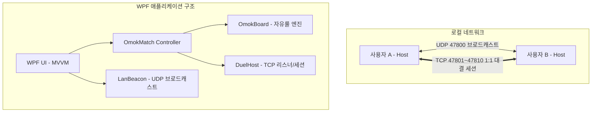

# 🏗️ 아키텍처 및 통신 프로토콜 명세

## 1. 아키텍처 개요

LAN 오목(OmokLan)은 중앙 서버가 없는 **완전 분산형 P2P (Peer-to-Peer)** 구조로 설계되었습니다.



---

## 2. UDP 브로드캐스트 탐색 (Discovery)

- **기본 포트**: `UDP 47800` (`SO_REUSEADDR` 활성화로 1개 PC에서 복수 인스턴스 실행 가능)
- **주기**: 2초마다 모든 활성 네트워크 어댑터의 서브넷 브로드캐스트 주소 및 `255.255.255.255`로 전송.
- **TTL 및 만료**: 수신된 피어 정보는 6초 동안 신호가 없으면 목록에서 자동 제거.
- **패킷 포맷 (UTF-8 JSON)**:
  ```json
  {
    "app": "OMOKLAN",
    "v": 1,
    "type": "HELLO",
    "id": "e3b0c44298fc1c149afbf4c8996fb924",
    "nick": "체스마스터",
    "avatar": 2,
    "status": "Available",
    "tcp": 47801
  }
  ```
  - `type`: `HELLO` (상태 알림) 또는 `BYE` (앱 종료 시 즉시 알림)
  - `status`: `Available` (대기중), `Dnd` (방해금지), `InGame` (게임중)

---

## 3. TCP 대결 세션 프로토콜

- **기본 포트**: `TCP 47801` (포트 충돌 시 47802~47810 순차 바인딩)
- **프레이밍 형식**: `[4바이트 Big-Endian 페이로드 길이][UTF-8 JSON 본문]` (최대 64KB)
- **하트비트**: 세션 수립 후 3초 간격으로 `PING` 전송, 10초간 응답 없을 시 연결 단절 처리.

### 메시지 타입 명세

| Type | 송신 방향 | 주요 필드 | 설명 |
|---|:---:|---|---|
| `CHALLENGE` | 신청자 → 피어 | `id`, `nick`, `avatar` | 1:1 오목 대결 신청 |
| `REPLY` | 피어 → 신청자 | `accept`, `reason` | 신청 수락(`true`) 또는 거절 사유(`dnd`, `busy`, `declined`, `timeout`) |
| `CANCEL` | 신청자 → 피어 | - | 상대방 응답 전 신청 취소 |
| `COIN` | 신청자 → 피어 | `round`, `color` | 코인 토스 결과 전달 (신청자의 색상: Black or White) |
| `MOVE` | 양방향 | `x`, `y`, `seq` | 오목 돌 착수 좌표 및 수 순번(1-based) |
| `TIMEOUT` | 양방향 | `color` | 30초 턴 제한시간 만료로 인한 시간패 선언 |
| `PROFILE` | 양방향 | `nick`, `avatar` | 게임 도중 프로필 변경 실시간 동기화 |
| `CHAT` | 양방향 | `nick`, `text` | 실시간 채팅 메시지 (최대 200자) |
| `RESIGN` | 양방향 | - | 기권 선언 |
| `REMATCH` | 양방향 | - | 대국 종료 후 재대결 요청 |
| `REMATCH_REPLY` | 양방향 | `accept` | 재대결 요청 수락/거절 |
| `PING` / `PONG` | 양방향 | - | 세션 생존 주기적 확인 |
| `LEAVE` | 양방향 | - | 정상 퇴장 알림 |

---

## 4. 보안 및 신뢰성 검증

1. **상태 불일치 및 변조 방지**:
   - `MOVE` 패킷 수신 시 양측 클라이언트의 규칙 엔진(`OmokBoard`)이 동일하게 좌표 범위, 빈 칸 여부, 턴 일치 여부, 시퀀스 일치 여부를 검증합니다.
   - 불일치 발생 시 즉시 `ProtocolError`로 판정하고 세션을 안전하게 종료합니다.
2. **단일 수신 펌프 큐 (`FramedChannel`)**:
   - 대결 수락 핸드셰이크 단계와 정식 대국 세션 간 TCP 소켓 핸들을 넘길 때 데이터 유실이 없도록 `Channel<Envelope>` 기반의 단일 펌프 큐를 사용합니다.
